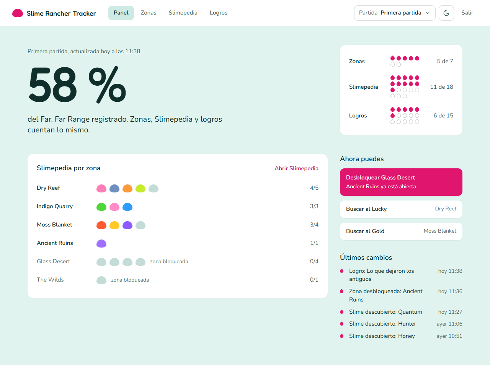
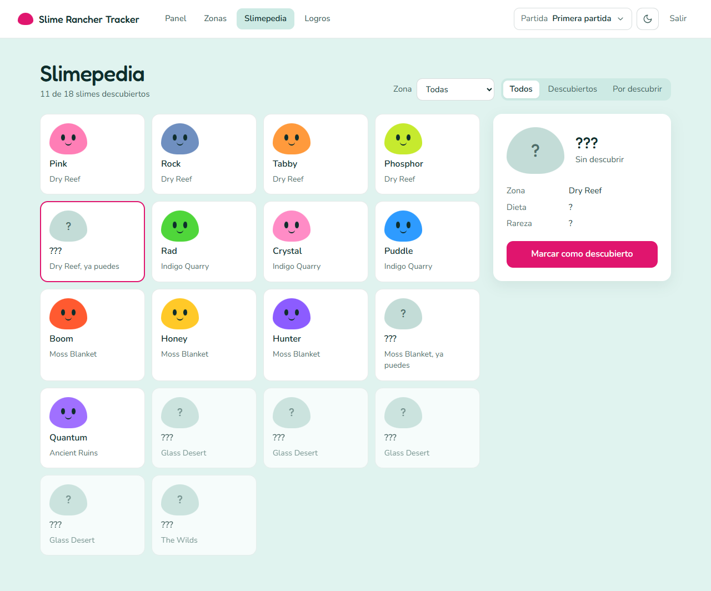
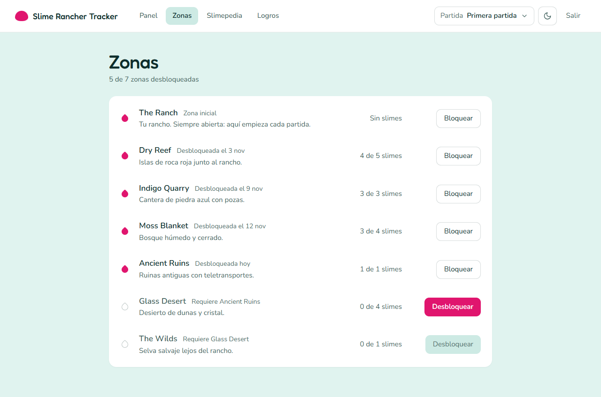
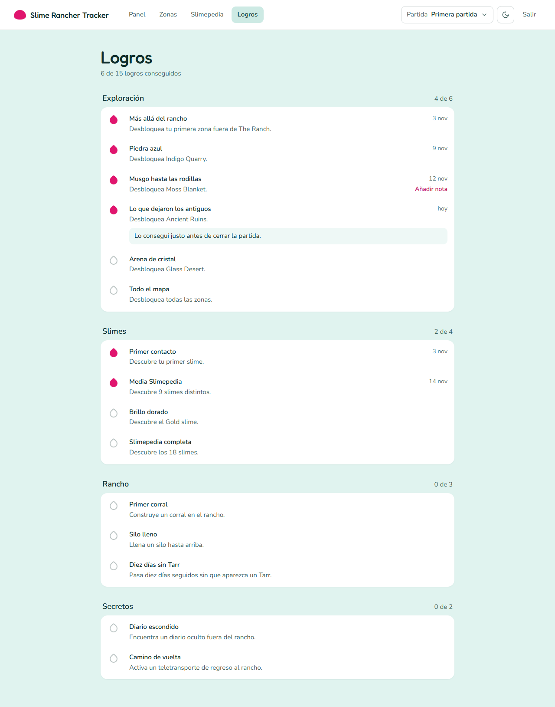
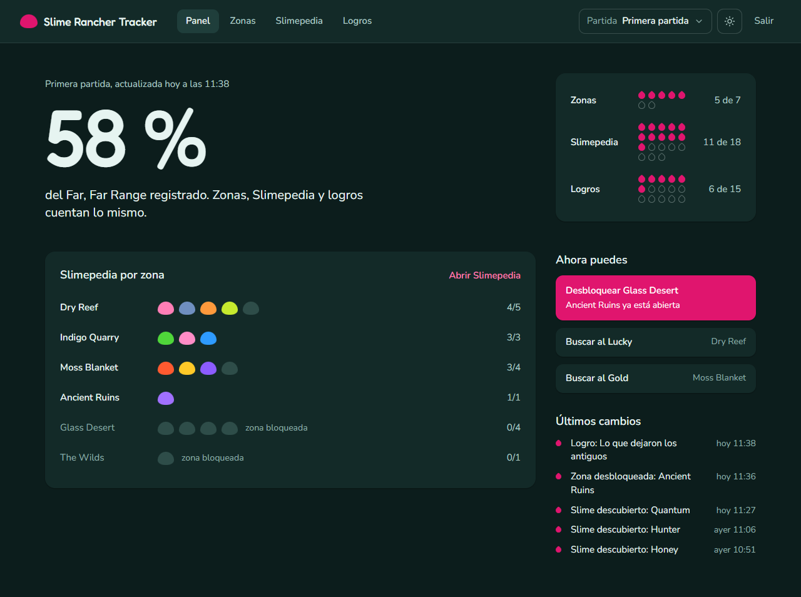
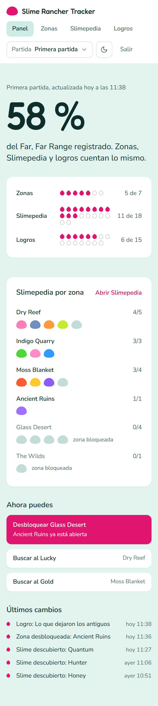
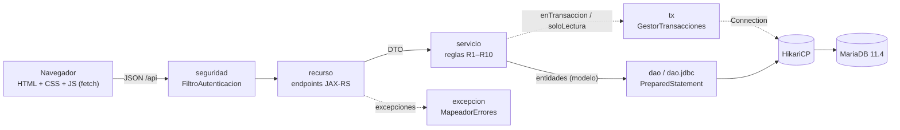
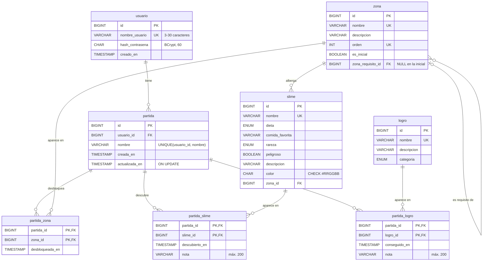
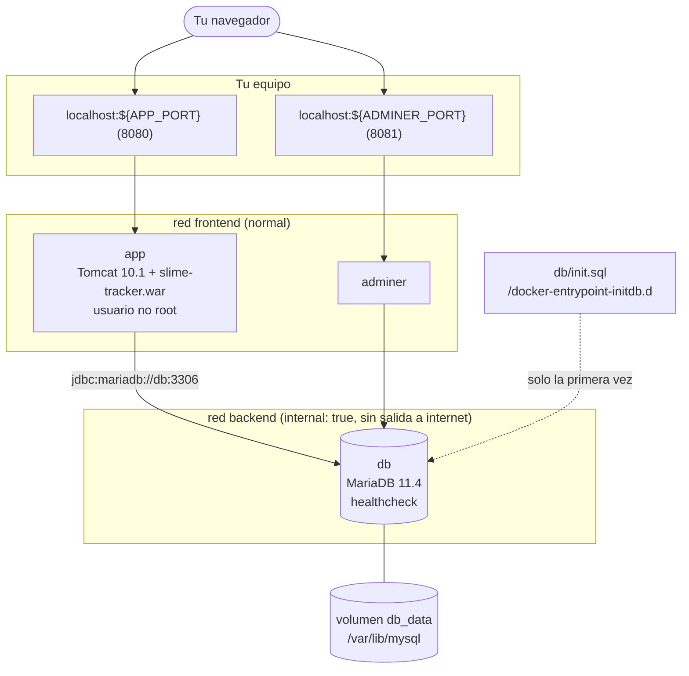
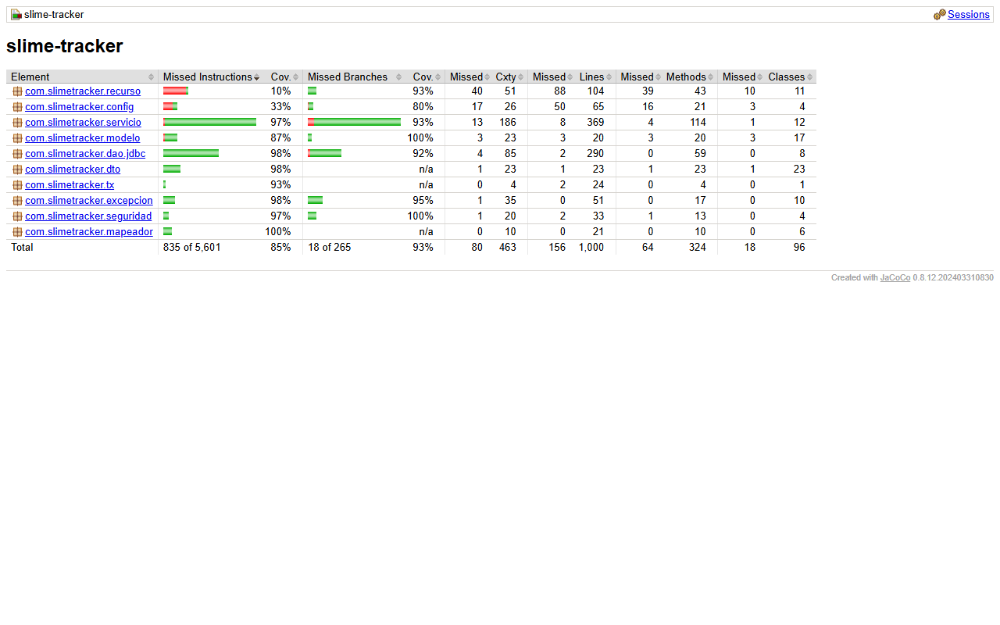

# Slime Rancher Tracker

**Repositorio:** https://github.com/Erbizo/Slime-Rancher-Tracker

Web para llevar el control de tus partidas de **Slime Rancher 1**. Cada usuario se registra, tiene varias partidas y en cada una marca tres cosas: **zonas desbloqueadas**, **slimes descubiertos** (la Slimepedia) y **logros conseguidos**. El panel calcula el porcentaje de progreso de la partida.

Práctica de *Acceso a Datos* (2.º DAM): aplicación Java por capas con JDBC, desplegada con Docker Compose.

| Panel | Slimepedia |
|---|---|
|  |  |
| **Zonas** | **Logros** |
|  |  |
| **Modo oscuro** | **Móvil** |
|  |  |

> El diseño de la interfaz se aprobó antes de programar: está en [`.docs/diseno/`](.docs/diseno/GUIA_VISUAL.md) (guía visual, capturas de referencia y HTML estático).

## Índice

1. [Stack y arquitectura](#stack-y-arquitectura)
2. [Modelo de datos](#modelo-de-datos)
3. [Contenedores](#contenedores)
4. [Despliegue paso a paso](#despliegue-paso-a-paso)
5. [URLs, puertos y credenciales de prueba](#urls-puertos-y-credenciales-de-prueba)
6. [Persistencia](#persistencia)
7. [Manual de uso](#manual-de-uso)
8. [API REST](#api-rest)
9. [Reglas de negocio](#reglas-de-negocio)
10. [Tests](#tests)
11. [Estructura de carpetas](#estructura-de-carpetas)

## Stack y arquitectura

| Capa | Tecnología |
|---|---|
| Presentación | HTML5 semántico, CSS3 (modo claro y oscuro con tokens), JavaScript vanilla con módulos ES y `fetch`. Sin frameworks ni CDN: las fuentes (Nunito y Fredoka, licencia OFL) se sirven desde el propio WAR |
| Control (API) | Jakarta EE 10: Jersey 3.1 (JAX-RS) + Jackson, sobre Tomcat 10.1 |
| Servicio | Java 21: reglas de negocio, validación y transacciones |
| Acceso a datos | JDBC puro con `PreparedStatement` y pool HikariCP; driver `mariadb-java-client` |
| Base de datos | MariaDB 11.4 (+ Adminer para verla) |
| Seguridad | Sesión HTTP (`JSESSIONID` HttpOnly + SameSite=Strict) y contraseñas con BCrypt |
| Tests | JUnit 5, Mockito, AssertJ, H2 en modo MariaDB y JaCoCo |
| Despliegue | Docker multi-stage y Docker Compose |



- **Dependencias en un solo sentido:** `recurso → servicio → dao → BD`. Los recursos solo ven DTOs (`dto`). Las entidades (`modelo`) no salen del servicio: los `mapeador` las convierten en DTOs.
- **Transacciones:** el servicio pide una `Connection` a `GestorTransacciones.enTransaccion(...)`, que hace `commit` si todo va bien y `rollback` ante cualquier excepción. Los métodos DAO reciben esa `Connection` como primer parámetro.
- **Errores:** los DAO traducen cada `SQLException` a excepciones propias (`EntidadDuplicadaException`, `IntegridadReferencialException`, `AccesoDatosException`). Los servicios lanzan `ValidacionException`, `NoEncontradoException`, `ReglaNegocioException`, `NoAutenticadoException` y `AccesoDenegadoException`. `MapeadorErrores` convierte cualquiera de ellas en el JSON de error común:

  ```json
  {"status":409,"error":"Conflict","mensaje":"Primero tienes que desbloquear Dry Reef.","timestamp":"2026-11-26T18:42:00Z"}
  ```
- **Configuración externalizada:** `ConfigBD` lee `DB_HOST`, `DB_PORT`, `DB_NAME`, `DB_USER` y `DB_PASSWORD` del entorno. Si falta alguna, la aplicación no arranca y el log dice cuáles faltan.

## Modelo de datos

Ocho tablas en `db/init.sql`: tres de catálogo (solo lectura), dos de usuarios y partidas, y tres tablas puente con el progreso de cada partida.



### Relaciones y por qué cada `ON DELETE`

| Relación | Tipo | ON DELETE / ON UPDATE | Motivo |
|---|---|---|---|
| `usuario` → `partida` | 1:N | `CASCADE` / `CASCADE` | Las partidas no tienen sentido sin su dueño: si se borra el usuario, se van con él |
| `zona` → `zona` (requisito) | 1:N reflexiva | `RESTRICT` | No se puede borrar una zona que es requisito de otra: el mapa quedaría roto |
| `zona` → `slime` | 1:N | `RESTRICT` / `CASCADE` | Un slime siempre vive en una zona; borrar la zona dejaría slimes huérfanos |
| `partida` ↔ `zona` (`partida_zona`) | N:M | partida `CASCADE`, zona `RESTRICT` | Borrar una partida borra su progreso; el catálogo no se puede borrar mientras haya progreso que lo use |
| `partida` ↔ `slime` (`partida_slime`) | N:M | partida `CASCADE`, slime `RESTRICT` | Igual que la anterior |
| `partida` ↔ `logro` (`partida_logro`) | N:M | partida `CASCADE`, logro `RESTRICT` | Igual que la anterior |

**Restricciones extra:**
- `CHECK` en `slime.color` (`^#[0-9A-F]{6}$`, en mayúsculas) y en la longitud de los nombres de partida, zona y slime.
- `UNIQUE(usuario_id, nombre)`: un usuario no puede tener dos partidas con el mismo nombre, pero dos usuarios distintos sí.
- La regla "una zona no puede ser requisito de sí misma" va en dos triggers: MariaDB no admite columnas `AUTO_INCREMENT` dentro de un `CHECK`.
- Todas las claves ajenas tienen índice: uno explícito, o la PK/UNIQUE cuando la FK es su primera columna.

## Contenedores



- **db** no publica ningún puerto y solo está en la red `backend`, que es `internal`: desde fuera de Docker no se llega a la base de datos.
- **app** y **adminer** están en las dos redes: en `backend` para hablar con la BD y en `frontend` para publicar su puerto.
- **Orden de arranque:** `app` y `adminer` esperan a que `db` esté `healthy` (`depends_on: condition: service_healthy`). El healthcheck es `healthcheck.sh --connect --innodb_initialized`.
- **Dockerfile multi-stage:** la primera etapa compila el WAR con Maven (primero copia el `pom.xml` y descarga las dependencias, así esa capa queda en caché). La segunda lo copia como `ROOT.war` en Tomcat, sin las aplicaciones de ejemplo y con el usuario sin privilegios `tomcat`.

## Despliegue paso a paso

Requisitos: Docker con Docker Compose v2. No hace falta Java ni Maven, porque se compila dentro del contenedor.

1. **Clona el repositorio** y entra en la carpeta.
2. **Crea el `.env`** a partir del ejemplo y cambia las contraseñas:

   ```bash
   cp .env.example .env            # bash
   ```
   ```powershell
   Copy-Item .env.example .env     # PowerShell
   ```

   | Variable | Para qué sirve | Ejemplo |
   |---|---|---|
   | `MARIADB_ROOT_PASSWORD` | Contraseña de `root` en MariaDB | `cambia_root_1234` |
   | `MARIADB_DATABASE` | Base de datos que se crea al arrancar por primera vez | `slime_tracker` |
   | `MARIADB_USER` | Usuario de la aplicación (solo tiene permisos sobre esa BD) | `slime_app` |
   | `MARIADB_PASSWORD` | Su contraseña | `cambia_app_1234` |
   | `DB_HOST` | Host de la BD visto desde `app` (el nombre del servicio) | `db` |
   | `DB_PORT` | Puerto de MariaDB dentro de la red de Docker | `3306` |
   | `DB_NAME` / `DB_USER` / `DB_PASSWORD` | Lo que usa la app para conectarse: **igual** que `MARIADB_DATABASE`, `MARIADB_USER` y `MARIADB_PASSWORD` | |
   | `APP_PORT` | Puerto de la web en tu equipo | `8080` |
   | `ADMINER_PORT` | Puerto de Adminer en tu equipo | `8081` |

3. **Construye y arranca** los tres servicios:

   ```bash
   docker compose up --build -d
   ```
4. **Comprueba que están arriba.** `db` tiene que salir como `healthy`:

   ```bash
   docker compose ps
   ```
5. **Mira el log de la aplicación** (sal con Ctrl+C):

   ```bash
   docker compose logs -f app
   ```
   Cuando aparezca `slime-tracker - Start completed.` y `Server startup in ...`, ya está lista. Para comprobarlo:

   ```bash
   curl http://localhost:8080/api/salud      # {"estado":"OK"}
   ```

Para pararlo: `docker compose down`. Los datos se conservan; mira [Persistencia](#persistencia).

## URLs, puertos y credenciales de prueba

| Servicio | URL | Acceso |
|---|---|---|
| Web | http://localhost:8080 | `rancher` / `slime1234`: usuario demo de las capturas, con 2 partidas (Primera partida al 58 % y Modo Rush al 22 %) |
| | | `vecina` / `slime5678`: segundo usuario, para comprobar que no puede tocar las partidas de `rancher` (403) |
| API | http://localhost:8080/api | La misma sesión que la web. Peticiones de ejemplo en [`docs/api.http`](docs/api.http) |
| Adminer | http://localhost:8081 | Sistema **MySQL**, servidor **`db`**, usuario `slime_app`, contraseña `cambia_app_1234`, base de datos `slime_tracker` (o lo que pusieras en tu `.env`) |

Los hashes BCrypt de `init.sql` son reales: se generaron con la misma librería que usa la aplicación.

## Persistencia

Los datos viven en el volumen con nombre `db_data`, no dentro del contenedor:

```bash
# 1. Entra como rancher y crea una partida llamada "Prueba persistencia"
docker compose down          # borra los contenedores, pero NO el volumen
docker compose up -d         # vuelve a crearlos
# 2. Recarga la web: "Prueba persistencia" sigue en Mis partidas
```

`init.sql` solo se ejecuta cuando el volumen está vacío. Para volver a los datos de prueba originales, borra también el volumen:

```bash
docker compose down -v
docker compose up -d
```

## Manual de uso

- **Entrar / Crear cuenta.** Al crear una cuenta se crea también la partida *Mi rancho* con *The Ranch* desbloqueada. Los errores salen debajo de cada campo, todos a la vez. El botón de sol/luna cambia entre modo claro y oscuro; por defecto sigue al sistema y la elección se recuerda.
- **Mis partidas** (selector *Partida* de la cabecera):
  - Crea partidas con el campo de arriba. El nombre no se puede repetir.
  - Pulsa el nombre de una partida para trabajar con ella.
  - *Renombrar* abre el nombre en línea (Enter guarda, Escape cancela).
  - *Borrar* pide confirmación en línea, porque borra también todas sus zonas, slimes y logros.
- **Panel.** Muestra el porcentaje global (la media de zonas, Slimepedia y logros) y un plort por cada elemento conseguido. Debajo, la Slimepedia por zona, *Ahora puedes* (zonas que ya se pueden desbloquear y slimes que ya se pueden buscar) y los últimos cambios.
- **Zonas.**
  - *Desbloquear* solo se activa si su zona requisito ya está abierta.
  - *Bloquear* se rechaza con un aviso si es la zona inicial, si otras zonas abiertas dependen de ella o si tiene slimes descubiertos. El aviso dice el motivo.
- **Slimepedia.** Los slimes sin descubrir son siluetas con «?». Se filtra por zona y por estado. Al pulsar una ficha, el detalle permite:
  - marcarlo como descubierto, si su zona está abierta;
  - escribir una nota (máximo 200 caracteres);
  - quitarlo de la Slimepedia.
- **Logros.** Hay cuatro categorías. El check con forma de plort marca y desmarca. En los conseguidos aparece *Añadir nota* / *Editar nota* al pasar el ratón o al llegar con el teclado; en el móvil se ve siempre.

## API REST

Todo cuelga de `/api` y habla JSON. Salvo `salud`, `auth/registro` y `auth/login`, todo exige sesión (401 sin ella). Además, en todo lo que lleva `{id}` la partida tiene que ser del usuario de la sesión (403 si no lo es).

| Método | Ruta | Éxito | Errores |
|---|---|---|---|
| GET | `/salud` | 200 | 500 |
| POST | `/auth/registro` | 201 + `Location` | 400, 409 |
| POST | `/auth/login` | 200 | 400, 401 |
| POST | `/auth/logout` | 204 | 401 |
| GET | `/auth/yo` | 200 | 401 |
| GET | `/zonas` · `/logros` | 200 | 401 |
| GET | `/slimes?zonaId&dieta&rareza` | 200 | 400, 401 |
| GET | `/partidas` | 200 | 401 |
| POST | `/partidas` | 201 + `Location` | 400, 401, 409 |
| GET · PUT · DELETE | `/partidas/{id}` | 200 · 200 · 204 | 400, 401, 403, 404, 409 |
| GET | `/partidas/{id}/progreso` | 200 | 400, 401, 403, 404 |
| GET | `/partidas/{id}/zonas` | 200 | 400, 401, 403, 404 |
| POST · DELETE | `/partidas/{id}/zonas/{zonaId}` | 201 · 204 | 400, 401, 403, 404, 409 |
| GET | `/partidas/{id}/slimes?zonaId&descubierto` | 200 | 400, 401, 403, 404 |
| POST | `/partidas/{id}/slimes` (varios: `{"slimeIds":[...]}`) | 201 | 400, 401, 403, 404, 409 |
| POST · DELETE | `/partidas/{id}/slimes/{slimeId}` | 201 · 204 | 400, 401, 403, 404, 409 |
| PUT | `/partidas/{id}/slimes/{slimeId}/nota` | 200 | 400, 401, 403, 404, 409 |
| GET | `/partidas/{id}/logros` | 200 | 400, 401, 403, 404 |
| POST · DELETE | `/partidas/{id}/logros/{logroId}` | 201 · 204 | 400, 401, 403, 404, 409 |
| PUT | `/partidas/{id}/logros/{logroId}/nota` | 200 | 400, 401, 403, 404, 409 |

Qué significa cada código de error:
- **400:** un id que no es un entero positivo, falta el cuerpo, JSON mal formado o tipos incorrectos, o un dato que no pasa la validación (con `campos`).
- **404:** el recurso o la ruta no existen.
- **405:** el método no está permitido en esa ruta.
- **415:** el cuerpo no se envía como JSON.
- **500:** error inesperado. Se registra con su traza en el log, pero el cliente solo recibe un mensaje genérico.

[`docs/api.http`](docs/api.http) tiene una petición por endpoint con su código esperado, incluidos los casos 400, 401, 403, 404, 405 y 409. Se ejecuta en orden con el cliente HTTP de IntelliJ.

## Reglas de negocio

| | Regla | Código si se incumple |
|---|---|---|
| R1 | **Registro:** usuario de 3–30 caracteres `[a-zA-Z0-9_]`; contraseña de mínimo 8 con al menos una letra y un número; las dos contraseñas iguales. Se devuelven todos los errores a la vez. En **una** transacción se crean el usuario (BCrypt) y la partida *Mi rancho* con la zona inicial desbloqueada | 400 / 409 si el nombre ya existe |
| R2 | **Login:** el mismo mensaje genérico tanto si el usuario no existe como si la contraseña está mal. Si el usuario no existe, se compara igualmente contra un hash ficticio, para que el tiempo de respuesta no lo delate. Al entrar se cambia el id de sesión | 401 |
| R3 | **Partida:** nombre de 1–40 caracteres, único por usuario. Crearla = insertarla + desbloquear la zona inicial, en una transacción | 400 / 409 |
| R4 | **Desbloquear zona:** la zona existe, no está ya desbloqueada y su requisito sí lo está («Primero tienes que desbloquear X.») | 404 / 409 |
| R5 | **Bloquear zona:** no se puede bloquear la inicial, ni una de la que dependan zonas desbloqueadas, ni una con slimes descubiertos. El mensaje dice cuáles | 409 |
| R6 | **Descubrir slime:** su zona tiene que estar desbloqueada y el slime no puede estar ya descubierto | 404 / 409 |
| R7 | **Descubrir varios:** todo o nada en **una** transacción. Si uno falla no se guarda ninguno, y el error dice cuál y por qué | 400 / 404 / 409 |
| R8 | **Logros:** marcar (409 si ya está), desmarcar y nota de máximo 200 caracteres, solo en conseguidos | 400 / 404 / 409 |
| R9 | Cualquier cambio de progreso actualiza `partida.actualizada_en` en la misma transacción | — |
| R10 | **Progreso:** % de zonas, de slimes y de logros, y el global como media de las tres fracciones **exactas**, redondeada con HALF_UP: (5/7 + 11/18 + 6/15) / 3 = 57,51 % → **58 %**. Incluye los slimes por zona, los últimos 10 cambios (el panel enseña los 5 primeros) y los siguientes pasos | 403 / 404 |

Además, **todos** los métodos de partida comprueban la propiedad: si la partida no existe da 404, y si es de otro usuario, 403.

## Tests

```bash
mvn clean verify
```

Sin Maven instalado, con la misma imagen que usa el `Dockerfile`:

```bash
docker run --rm -v "$PWD":/app -w /app maven:3.9-eclipse-temurin-21 mvn clean verify
```

No necesitan Docker ni MariaDB: los de DAO usan **H2 en memoria en modo MariaDB**, y [`schema-h2.sql`](src/test/resources/schema-h2.sql) recrea el esquema y los datos antes de cada test. Son **255 tests**:

| Qué se prueba | Clase | Cómo |
|---|---|---|
| CRUD de cada DAO y casos límite: duplicados, mismo nombre en otro usuario, id inexistente → `Optional.empty()`, update/delete inexistente → 0 filas, borrado en cascada | `*DaoJdbcTest` | Integración con H2 |
| Que cualquier fallo de JDBC se traduce a una excepción propia, en todos los métodos DAO | `TraduccionErroresDaoTest` | Integración con H2 |
| Que una excepción a mitad deshace **todo**, y que se restaura el autocommit | `GestorTransaccionesTest` | Integración con H2 |
| R7 de punta a punta: con un slime que falla no se guarda ninguno | `DescubrirVariosIntegracionTest` | Integración con H2 |
| R1–R10 en el camino feliz y en cada error (400 con varios campos, 401, 403, 404, 409), con `verify(..., never())` para comprobar que no se escribe nada | `*ServicioTest` | Mockito; el `GestorTransacciones` mockeado ejecuta la lambda |
| Códigos HTTP y formato del error; filtro de autenticación; sesión; BCrypt (incluidos los hashes reales de `init.sql`); parámetros de ruta; configuración | `MapeadorErroresTest`, `SeguridadTest`, `ParametrosTest`, `ConfigBDTest` | Unitarios |

El informe de cobertura queda en `target/site/jacoco/index.html`. Cobertura de líneas: **servicio 97,8 %**, **dao 99,3 %**, total 84,5 %.



## Estructura de carpetas

```
.
├── db/init.sql                    Esquema (DDL) y datos de prueba (DML) de MariaDB
├── docs/
│   ├── api.http                   Una petición por endpoint, con el código esperado
│   └── img/                       Capturas del README
├── src/main/java/com/slimetracker/
│   ├── config/                    ConfigBD (entorno), ProveedorDataSource (Hikari), ContextoApp, listener de arranque
│   ├── recurso/                   Endpoints JAX-RS, validación de entrada, configuración de Jackson
│   ├── servicio/                  Reglas R1–R10, validaciones y transacciones
│   ├── dao/  ·  dao/jdbc/         Interfaces DAO e implementaciones JDBC
│   ├── tx/                        GestorTransacciones y FuncionSql
│   ├── modelo/                    Entidades (= tablas) y proyecciones de lectura
│   ├── dto/                       Records de entrada (…Peticion) y salida (…Respuesta)
│   ├── mapeador/                  Entidad → DTO
│   ├── seguridad/                 Filtro de autenticación, sesión y BCrypt
│   └── excepcion/                 Excepciones propias, traductor de SQLException y MapeadorErrores
├── src/main/webapp/
│   ├── *.html                     login, registro, partidas, index (panel), zonas, slimepedia, logros
│   ├── css/estilos.css            Tokens de color de los dos modos y componentes del diseño
│   ├── js/                        api.js (fetch), ui.js, estado.js, fechas.js, cabecera.js, tema.js
│   ├── js/paginas/                Un módulo por página
│   ├── fuentes/                   Nunito y Fredoka (woff2, OFL)
│   ├── WEB-INF/web.xml            Sesión de 30 min y cookie HttpOnly
│   └── META-INF/context.xml       Cookie SameSite=Strict
├── src/test/                      Tests (JUnit 5 + Mockito + H2) y schema-h2.sql
├── Dockerfile                     Multi-stage: Maven → Tomcat, usuario no root
├── docker-compose.yml             db + app + adminer, redes backend/frontend, volumen db_data
├── .env.example                   Variables de entorno de ejemplo (el .env real no se sube)
├── AI_WORKFLOW.md                 Registro del trabajo con el agente de IA
└── .docs/                         Enunciado, prompts por fase y diseño aprobado
```
